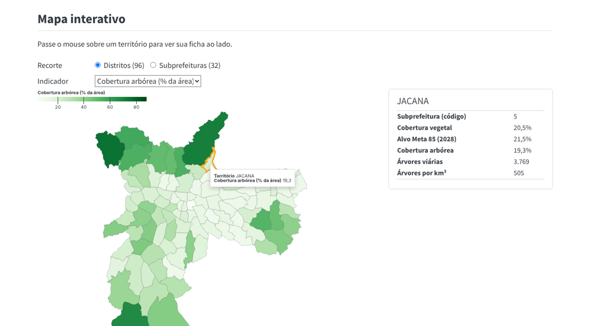

::: {.callout-warning appearance="simple" title="Em andamento · v0.2"}
Primeira versão do painel com dados reais (extração de 20/11/2026). Próximas versões: poda × remoção × plantio pelos contratos, pedidos do SP156 por distrito e índice de prioridade de plantio.
:::

::: {.callout-note appearance="minimal"}
Desenvolvido com dados abertos. Não representa posição oficial da Prefeitura de São Paulo.
:::

[Abrir o observatório](https://micadw.github.io/arborizacao-sp/){.btn .btn-primary}
[Repositório no GitHub](https://github.com/micadw/arborizacao-sp){.btn .btn-outline-primary}

## Resumo

Um observatório que junta, numa mesma base, o que a cidade publica sobre suas árvores e compara com as metas oficiais. O mapa mostra 96 distritos e 32 subprefeituras; ao passar o mouse, cada território abre uma ficha com cobertura vegetal, alvo da Meta 85 do PlanClima, árvores viárias, quedas e orçamento.

**Achados iniciais (extração de 20/11/2026):**

- A camada de arborização viária do GeoSampa tem **652.929 árvores**, mas sem espécie registrada — o que impede, por ora, medir nativas da Mata Atlântica e carbono.
- A cobertura vegetal do município é de **48%** (mapeamento de 2017), com cobertura arbórea que vai de **4,9% no Brás a 88,1% em Marsilac**.
- Em 2026, as ações de áreas verdes, arborização e viveiros tinham **R$ 430 milhões liquidados de R$ 610 milhões** atualizados. Não há dotação separada para poda, remoção ou plantio: tudo passa pela ação 2705 (subprefeituras, SMSUB e SME) e pela 6655 (SVMA).
- Foram registradas **1.836 quedas de árvore** de janeiro a setembro de 2026.

## O que o observatório faz

- **Painel:** cartões de meta e mapa interativo por distrito ou subprefeitura.
- **Metas:** atingimento visual das metas do Programa de Metas, PlanClima e PMAU, e a Meta 85 (cobertura vegetal +1 p.p. por distrito até 2028).
- **Orçamento:** ações ligadas às árvores, quem executa (subprefeituras, SMSUB, SME, SVMA) e execução por subprefeitura, 2024–2026.
- **Sprints e fontes:** backlog, decisões e catálogo de fontes com links.

## Dados, método e licenças

Fontes: GeoSampa (arborização viária, Mapeamento Digital da Cobertura Vegetal, distritos, subprefeituras, quedas registradas pela Defesa Civil) e Portal de Dados Abertos da PMSP (execução orçamentária). A cobertura por distrito é calculada pela interseção exata dos 272 mil polígonos de vegetação com os limites distritais. Código sob MIT; textos sob CC BY 4.0.
