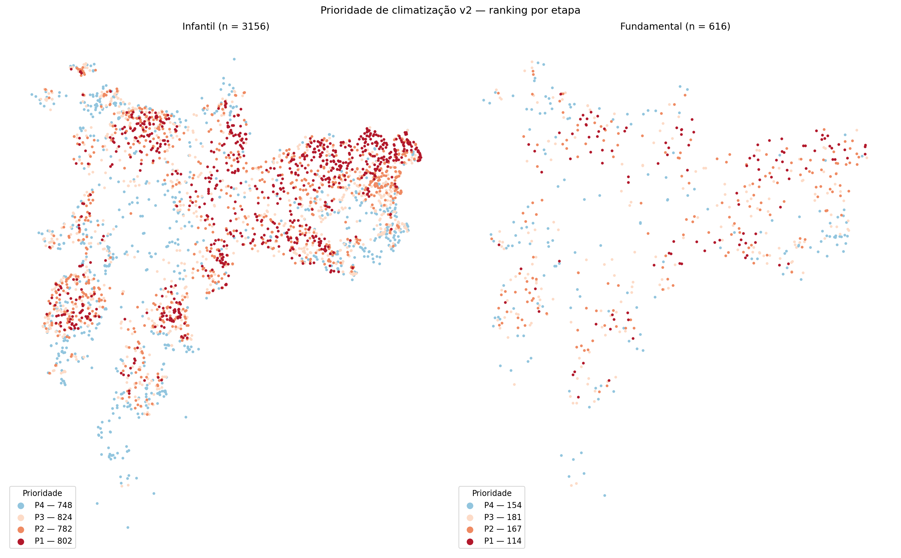

::: {.callout-note appearance="minimal"}
Desenvolvido com dados abertos. Não representa posição oficial da Prefeitura de São Paulo.
:::

[Repositório no GitHub](https://github.com/micadw/escolas-calor-sp){.btn .btn-outline-primary}
[Dados (Zenodo)](https://doi.org/10.5281/zenodo.24401164){.btn .btn-outline-secondary}
[Abrir no Colab](https://colab.research.google.com/github/micadw/escolas-calor-sp/blob/main/notebooks/01_ingestao_escolas.ipynb){.btn .btn-outline-secondary}

**Baixar a base por escola:** [Planilha Excel (.xlsx)](../../data/escolas_calor_sp_v2.xlsx){.btn .btn-success download=""} [CSV (.csv)](../../data/escolas_calor_sp_v2.csv){.btn .btn-outline-success download=""}

## Resumo

O projeto mede o calor no entorno de cada escola municipal com imagens Landsat 8/9 (2019–2025) e estações do INMET.
São calculadas ilha de calor, sensação térmica e horas de desconforto no horário de aula, cruzadas com idade dos alunos,
matrículas e vegetação. Resultado: cinco classes de calor e prioridades P1–P4 por etapa de ensino.

**Achados:** 1.646 das 3.772 escolas estão nas classes "muito quente" ou "extrema" (ilha de calor ≥ 6 °C).
São Miguel, Penha e Freguesia/Brasilândia concentram as escolas mais quentes.

## Mapa interativo

Clique em uma escola para ver os valores. Use o seletor de camadas (canto superior direito) para ligar e desligar classes.

```{python}
#| echo: false
#| warning: false
import pandas as pd, folium

d = pd.read_csv("../../data/escolas_temperatura.csv")
cores = {"1": "#2c7bb6", "2": "#abd9e9", "3": "#fee090", "4": "#fdae61", "5": "#d7191c"}

m = folium.Map(location=[-23.62, -46.60], zoom_start=10, tiles=None)
folium.TileLayer("OpenStreetMap", name="Mapa base (OpenStreetMap)", control=False, opacity=0.6).add_to(m)
for classe, g in d.sort_values("classe_calor").groupby("classe_calor"):
    camada = folium.FeatureGroup(name=f"{classe} ({len(g)})", show=True)
    cor = cores[str(classe)[0]]
    for r in g.itertuples():
        folium.CircleMarker(
            location=[r.lat, r.lon], radius=3, color=cor, fill=True, fill_color=cor,
            fill_opacity=0.9, weight=0,
            popup=folium.Popup(
                f"<b>{r.nome}</b><br>{r.tipo} · {r.rede} · DRE {r.dre}<br>"
                f"Ilha de calor: <b>{r.ilha_calor_c:.1f} °C</b><br>"
                f"Temp. superfície p90: {r.lst_p90_c:.1f} °C<br>"
                f"Horas/ano com sensação ≥ 32 °C: {r.horas_sensacao_32:.0f}<br>"
                f"Prioridade ({r.etapa}): <b>{r.prioridade_v2}</b>", max_width=260),
        ).add_to(camada)
    camada.add_to(m)
folium.LayerControl(collapsed=False).add_to(m)
m
```

## Método

1. Cadastro de escolas da SME (rede direta e conveniada).
2. Temperatura de superfície Landsat com máscara de nuvem, meses letivos quentes.
3. Estatística zonal com peso pela fração de cada pixel de 30 m num raio de 100 m.
4. Sensação térmica e graus-hora em horas letivas (INMET + diferença local do satélite).
5. Priorização por exposição (0,60), sensibilidade (0,15) e vegetação (0,25), separada por etapa.



## Ferramentas

Python · pandas · geopandas · rasterio · exactextract · STAC / Planetary Computer · Google Earth Engine · Google Colab · Quarto
