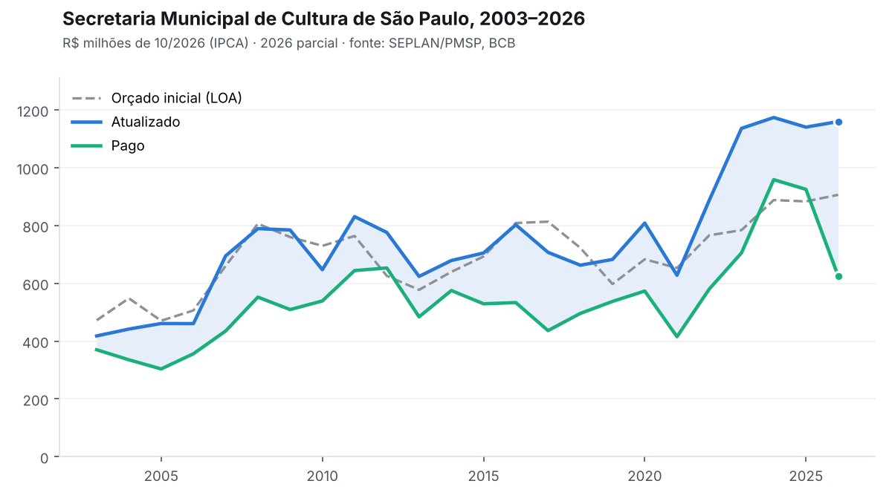

::: {.callout-warning appearance="simple" title="Em andamento · v0.1.1"}
Piloto em desenvolvimento, atualizado diariamente. Próximas versões: empenhos e credores por dotação, decretos de crédito e emendas da Câmara.
:::

::: {.callout-note appearance="minimal"}
Desenvolvido com dados abertos. Não representa posição oficial da Prefeitura de São Paulo.
:::

[Abrir a ferramenta](https://micadw.github.io/dsa-orcamento-cultura-sp/){.btn .btn-primary}
[Repositório no GitHub](https://github.com/micadw/dsa-orcamento-cultura-sp){.btn .btn-outline-primary}
[DOI (Zenodo)](https://doi.org/10.5281/zenodo.24399304){.btn .btn-outline-secondary}
[Dados (Zenodo)](https://doi.org/10.5281/zenodo.24399591){.btn .btn-outline-secondary}

## Resumo

Ferramenta para buscar qualquer dotação do orçamento da cultura da Prefeitura de São Paulo pelo código ou por palavra e acompanhar o caminho do dinheiro: orçado na lei, créditos adicionais, congelamentos, empenho, liquidação e pagamento. Os dados vêm das bases abertas de execução orçamentária da Prefeitura (SEPLAN/SOF), coletadas todo dia por GitHub Actions, e a série 2003–2026 é corrigida pelo IPCA do Banco Central.

**Achados iniciais (até 19/11/2026):** a Secretaria Municipal de Cultura começou 2026 com R$ 906,2 milhões aprovados e chegou a R$ 1,16 bilhão com créditos adicionais (+28%); 80% foi empenhado e 54% pago. No Fundo Municipal de Cultura, o fomento às linguagens artísticas caiu de R$ 70,7 milhões aprovados para R$ 60 mil.

## O que a ferramenta faz

- **Início:** resumo em linguagem simples, alertas automáticos e as maiores ações.
- **Explorar:** busca por código de dotação ou palavra, filtros, estatística descritiva, quebra por programa, ação, natureza e fonte, e download em CSV.
- **Ficha da dotação:** link próprio, linha do tempo do orçado ao pago e dotações da mesma ação.
- **Série 2003–2026:** valores nominais e corrigidos pelo IPCA, taxas de execução e peso no orçamento da Prefeitura.

## Dados, método e licenças

Fontes: SEPLAN/PMSP (execução orçamentária, dados abertos), BCB/SGS 433 (IPCA). Correção: fator = IPCA do mês-base ÷ IPCA de dezembro de cada ano. Código sob MIT; dados tratados e textos sob CC BY 4.0. Nomes de pessoa física nas descrições oficiais são mascarados (LGPD).

**Como citar:** Farina, A. F. (2026). *Orçamento da Cultura em São Paulo: da proposta ao pagamento* Zenodo. <https://doi.org/10.5281/zenodo.24399304> · Dados: <https://doi.org/10.5281/zenodo.24399591>
